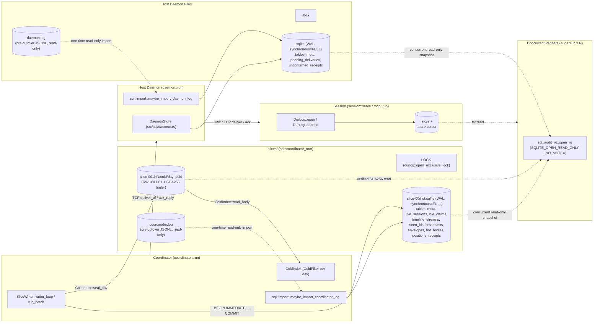
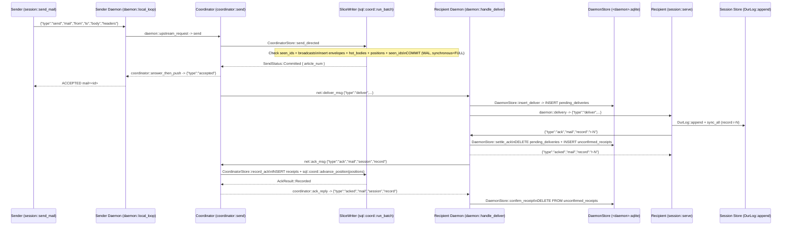
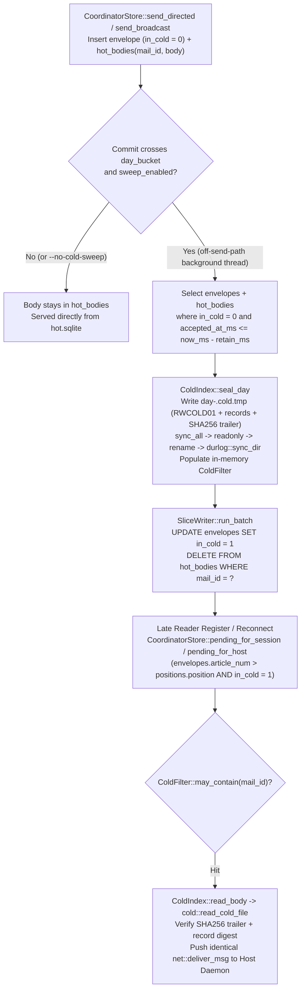
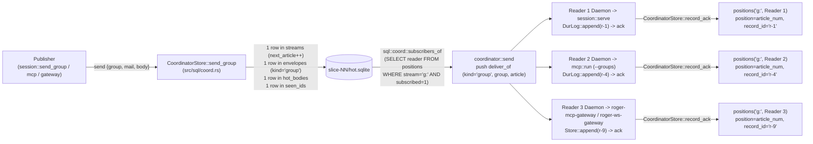
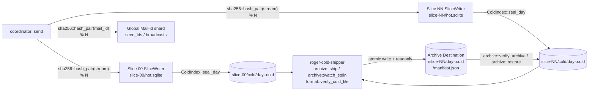

# Roger-Wilco Storage Architecture

This document maps the SQLite hot/cold storage engine as built in `src/sql/`, `src/cold.rs`, `src/coordinator.rs`, `src/daemon.rs`, `src/session.rs`, and `src/audit.rs`. Every box and arrow names an actual function, SQLite table, or on-disk file in the repository.

## 1. Processes and On-Disk Files

- **Coordinator (`coordinator::run` -> `CoordinatorStore::open`)**: resolves `--data <path>` via `sql::coordinator_root` to `<data>.slices/`, holds an exclusive OS lock on `<data>.slices/LOCK` via `durlog::open_exclusive_lock`, imports any pre-cutover JSONL `coordinator.log` read-only once via `sql::import::maybe_import_coordinator_log` (leaving `<data>` untouched on disk), and runs one dedicated group-commit `SliceWriter` (`writer_loop` / `run_batch`) per `slice-NN/hot.sqlite` (`WAL`, `synchronous=FULL`) alongside `slice-NN/cold/day-<bucket>.cold` (`ColdIndex`).
- **Host Daemon (`daemon::run` -> `DaemonStore::open`)**: holds `<daemon_data>.lock`, imports any pre-cutover JSONL `daemon.log` read-only once via `sql::import::maybe_import_daemon_log`, and keeps only active `pending_deliveries` and `unconfirmed_receipts` in `<daemon_data>.sqlite` (`WAL`, `synchronous=FULL`).
- **Sessions (`session::serve`, `mcp::run`, Optional gateway modules)**: keep append-only JSONL `.store` files (`DurLog::open`) and atomic `.store.cursor` files, enforcing Store-before-Ack.
- **Concurrent Verifiers (`audit::run` -> `sql::audit_ro::read_coordinator_records` / `read_daemon_records`)**: open `hot.sqlite` and `<daemon_data>.sqlite` with `SQLITE_OPEN_READ_ONLY | SQLITE_OPEN_NO_MUTEX` inside `BEGIN DEFERRED` snapshots plus `ColdIndex::load`, allowing any number of concurrent read-only `roger audit` readers alongside live writers.

## 2. One Mail's Path (Send to Confirmed Receipt and Daemon Row Deletion)

Every Mail id is indexed under `seen_ids(mail_id PRIMARY KEY)` and `envelopes(mail_id UNIQUE)` and is never reused. `Accepted` is answered only after `SliceWriter::run_batch` commits durably (`synchronous=FULL`). On the recipient host, `DaemonStore::settle_ack` atomically deletes the `pending_deliveries` row and inserts an `unconfirmed_receipts` row; once the coordinator commits the reader's `positions` and `receipts` rows and answers `acked`, `DaemonStore::confirm_receipt` deletes the `unconfirmed_receipts` row.

## 3. Body Lifecycle: Hot Tier (0-30 Days) -> Cold Sweep -> Late-Reader Cold Restore

Metadata (`envelopes`, `seen_ids`, `streams`, `positions`, `receipts`, `timeline`) stays in `hot.sqlite` indefinitely. Bodies start in `hot_bodies`. On the first commit after a day boundary (`day_bucket > last_swept_day`, unless `--no-cold-sweep` is set), `CoordinatorStore` spawns an off-send-path sweep that reads bodies older than `retain_ms` (default 30 days), seals them into `slice-NN/cold/day-<bucket>.cold` via `ColdIndex::seal_day` (`RWCOLD01` header, sorted JSON records with per-body SHA-256 `digest`, trailing whole-file `SHA256:` digest, atomic rename, read-only permissions, and an in-memory 6-probe `ColdFilter`), and then marks `envelopes.in_cold = 1` and deletes those rows from `hot_bodies`. When a late reader connects (`register` -> `CoordinatorStore::pending_for_session` or `hello` -> `pending_for_host`) with `article_num > positions.position` on a row where `in_cold = 1`, `ColdIndex::read_body` checks the day's `ColdFilter` in memory and, on a hit, verifies and restores the body from `day-<bucket>.cold`.

## 4. Named Group Post Fanout and Per-Reader Positions

A Group post (`session::send_group_mail` / `roger adapter --groups` / `roger mcp --groups` / `roger-mcp-gateway` / `roger-ws-gateway`) commits **one** `envelopes` row (`stream = "g:<group>"`, monotonic `article_num` from `streams.next_article`, `kind = "group"`) and **one** `hot_bodies` row via `CoordinatorStore::send_group`, then queries `sql::coord::subscribers_of` (`positions WHERE stream = ? AND subscribed = 1`) and pushes `coordinator::deliver_of` to each subscribed reader's connected `Host Daemon`. Each reader writes its local `.store` once (`DurLog::append`) and sends `ack`; `CoordinatorStore::record_ack` inserts `receipts(mail_id, reader, ...)` and calls `sql::coord::advance_position` to advance that reader's single `positions(stream, reader)` row across contiguous acked article numbers.

## 5. Multi-Slice Writers (`--slices <n>`) and Cold Archive Shipping (`roger-cold-shipper`)

When `roger coordinator --slices <n>` runs with `n > 1`, `CoordinatorStore` opens `slice-00/hot.sqlite` through `slice-(n-1)/hot.sqlite`, each owned by its own independent group-commit `SliceWriter` thread (`sql::coord::writer_loop`). Streams (`m:<address>`, `g:<group>`) route to `sha256::hash_pair(stream.as_bytes()).0 % num_slices`, while `seen_ids` and `broadcasts` route to `sha256::hash_pair(mail_id.as_bytes()).0 % num_slices` so Mail id non-reuse holds globally across all slices while writes scale across independent `WAL` writers. Each slice directory `slice-NN/` is self-contained (`hot.sqlite` + `cold/`) and movable as files.

Alongside the core, the standalone Optional module `modules/cold-shipper/` (`roger-cold-shipper`) scans `slice-*/cold/day-*.cold` via `archive::ship` (or event-driven `archive::watch_stdin`), verifies `format::verify_cold_file` (`RWCOLD01`, per-record `digest`, and `SHA256:` trailer), atomically writes read-only copies plus `manifest.json` (`roger-cold-manifest/1`) to an archive destination, checks archive integrity via `archive::verify_archive`, and restores missing local day files via `archive::restore`.

